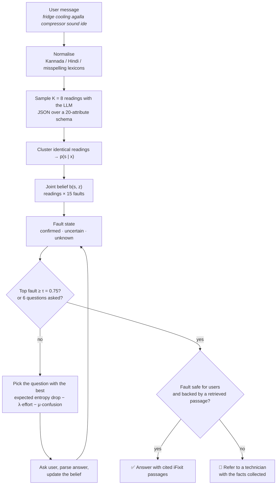

<div align="center">

# 🧊 Query2Diagnose

### Troubleshooting a broken fridge from messages like *"fridge cooling agalla compressor sound ide"*

**An assistant that knows the difference between *"I don't understand you"* and *"I don't know the fault yet"*,**
**asks the question that settles the right one, and hands unsafe repairs to a technician.**

[](pyproject.toml)
[](tests/)
[](REPRODUCE.md)
[](results/runs/20261029T170525Z)
[](REPRODUCE.md)
[](LICENSE)
[](NOTICE)

[What it does](#-what-it-does) ·
[Results](#-results) ·
[How it works](#-how-it-works) ·
[Benchmark](#-the-benchmark) ·
[Quick start](#-quick-start) ·
[Reproduce](#-reproduce-every-number) ·
[Team](#-team) ·
[Cite](#-citation)

</div>

---

## 💬 What it does

A real dialogue from our saved run (`results/runs/20261029T170525Z/q2d.jsonl`, variant `c0179-codemixed_kn`, seed 0):

```text
User      freezer alli frost jaasti aagide, compressor run aagtide, door rubber sari ide
          (Kannada-English: "lots of frost in the freezer, the compressor is running, the door rubber is fine")

Q2D  →    Is it a frost-free fridge, or a direct-cool one that you defrost by hand?
User      Direct-cool (manual defrost)

Q2D  →    Is there frost or ice on the back wall inside the freezer or fridge?
User      Yes, there is frost

Q2D  ✓    Fault: Excess frost in a manual-defrost unit (needs defrosting)   (confidence 0.83)
          Grounded in iFixit, "Frost Buildup in Freezer" → "Cause 4: Excessive Frost or Ice Buildup"
```

Two questions, the right fault, a cited source. When the fault involves the compressor, the sealed refrigerant
system, the start relay or internal wiring, Query2Diagnose never suggests a DIY fix: it refers to a technician and
passes on everything it has learned.

The idea behind it: a code-mixed, misspelt or half-finished message creates **two different kinds of doubt**,
and they need different questions.

| Doubt | Symbol | Example | The right next question |
|---|---|---|---|
| **Linguistic**: what did the user say? | $H_L$ | Does *"sound ide"* mean "it makes a noise" or "the compressor is running"? | a **clarification** |
| **Diagnostic**: which fault is it? | $H_D$ | Understood perfectly, but several faults still fit | a **diagnostic** question |

Query2Diagnose tracks both at once and lets one scoring rule decide which question is worth the user's time.

---

## 📊 Results

Full test grid, run locally on one laptop GPU: **60 test cases × 7 input conditions + 30 trilingual stress
items = 450 variants, 8 systems, 3 seeds, 10,800 dialogues**. Every number below comes from
[`results/runs/20261029T170525Z/summary.json`](results/runs/20261029T170525Z/summary.json) and is regenerated by
`make tables`; nothing is typed by hand. ± is the half-width of the 95 % case-level bootstrap interval.

| System | Action macro-F1 | Action accuracy | Right fault ranked 1st | Questions asked | Calibration error (ECE) ↓ | Unsafe DIY advice ↓ |
|---|:---:|:---:|:---:|:---:|:---:|:---:|
| B1 · LLM answers directly | 0.23 ± 0.07 | 0.32 ± 0.07 | 0.22 | 0.0 | 0.55 | 42.9 % |
| B2 · LLM asks its own questions | **0.37 ± 0.08** | 0.34 ± 0.09 | 0.36 | 5.2 | 0.46 | 69.9 % |
| B3 · information gain over faults only | 0.22 ± 0.08 | **0.51 ± 0.12** | **0.68** | 5.5 | **0.19** | **0.0 %** |
| **Query2Diagnose** | 0.19 ± 0.07 | **0.51 ± 0.12** | 0.65 | 5.7 | **0.19** | **0.0 %** |

<sup>All conditions pooled, stress items excluded (1,260 dialogues per system). Per-condition numbers:
[`paper/tables/main_results.tex`](paper/tables/main_results.tex).</sup>

### What we found, good and bad

**✅ Works**

- **Safe.** The two belief-based systems never gave do-it-yourself advice on an unsafe fault. The LLM baselines
  did so in 42.9 % and 69.9 % of those cases, even though their output is forced to "refer" whenever they name an
  unsafe fault. They named a wrong, harmless-looking one instead.
- **Honest about confidence.** Calibration error 0.19 against 0.46 and 0.55 for the LLM baselines.
- **Finds the fault.** The correct fault is ranked first in 64.8 % of Q2D dialogues against 36.2 % for B2, and
  action accuracy beats both LLM baselines (exact McNemar test, Holm-corrected: p < 10⁻¹³ against B2,
  p < 10⁻²⁵ against B1).
- **Steady under noise.** Q2D loses at most 0.04 macro-F1 in any input condition. B1 drops from 0.33 on clean
  text to 0.11 under combined Kannada–English noise.
- **Kannada vs Hindi.** No significant difference for any system (all McNemar p ≥ 0.058).

**❌ Doesn't (yet)**

- **Refers too often.** REFER recall is 0.97 but precision only 0.48, which is why Q2D has the lowest
  macro-F1. Of its 663 failed dialogues, 480 end at the six-question budget **with the right fault on top**,
  just short of the 0.75 confidence it needs to answer.
- **Separating $H_L$ gives no measurable gain.** Q2D and B3 are not significantly different (p = 0.49), and
  removing $H_L$ even scores slightly higher (0.22 vs 0.19, overlapping intervals).
- **Why:** at the start of a dialogue $H_L$ is 1.47 bits for *clean* English, 1.50 for code-mixed text and only
  1.07 for the noisiest messages. Sampling the parser at temperature 0.7 measures the parser's own variability
  more than the noise in the message.
- **The real bottleneck is the hand-built hypothesis model.** With a sharper weight set, Q2D reaches 0.42 and
  B3 0.41 macro-F1, above B2. That comparison used the test split, so we report it as a diagnosis, not a
  result.

<details>
<summary><b>Ablations</b> (remove one component at a time)</summary>

| Variant | Macro-F1 | Code-mixed F1 | Questions | ECE | Unsafe |
|---|:---:|:---:|:---:|:---:|:---:|
| Query2Diagnose | 0.19 ± 0.07 | 0.18 | 5.7 | 0.19 | 0.00 |
| − $H_L$ (one greedy reading, no clarification) | 0.22 ± 0.08 | 0.22 | 5.5 | 0.19 | 0.00 |
| − fault state (LLM re-reads the dialogue instead) | 0.19 ± 0.07 | 0.16 | 5.4 | 0.11 | 0.04 |
| − cost/clarity (λ = μ = 0) | 0.19 ± 0.07 | 0.18 | 5.7 | 0.19 | 0.00 |
| − normalisation | 0.19 ± 0.07 | 0.20 | 5.7 | 0.19 | 0.01 |

Tuning on the validation split chose λ = μ = 0, so the cost/clarity ablation equals the full system here.
Removing the fault state is the only change that clearly hurts: fault accuracy falls from 0.65 to 0.58 and
unsafe advice appears.

</details>

<details>
<summary><b>Sensitivity to the hypothesis weights</b> (seed 0, macro-F1 with mean questions)</summary>

| Weight set | B3 | Query2Diagnose |
|---|:---:|:---:|
| base (used everywhere else) | 0.22 ± 0.08 (5.5) | 0.18 ± 0.07 (5.7) |
| flat | 0.06 ± 0.02 (5.9) | 0.06 ± 0.02 (6.0) |
| sharp | 0.41 ± 0.10 (4.7) | 0.42 ± 0.11 (5.1) |
| soft atypical | 0.19 ± 0.08 (5.7) | 0.12 ± 0.05 (5.8) |
| hard atypical | 0.26 ± 0.09 (5.3) | 0.21 ± 0.08 (5.5) |

</details>

<details>
<summary><b>More</b>: question quality, understanding, stress set, error analysis</summary>

- **Information gain per question** (same shared observer for every system): Q2D 0.178 bits, B3 0.161, B2 0.154.
- **Slot F1 of the top reading**: Q2D 0.752 (8 samples) vs B3 0.732 (one greedy parse).
- **Trilingual stress set** (Kannada + Hindi + English in one message, 90 dialogues, reported separately):
  Q2D macro-F1 0.24, fault accuracy 0.80.
- **Error analysis** with real transcripts: [`results/error_analysis.md`](results/error_analysis.md). Of 663 Q2D
  failures: 51.6 % hypothesis-model gaps, 24.7 % misread clarification answers, 16.6 % missed code-mixed tokens,
  5.0 % retrieval misses, 2.1 % wrong answers, 0.0 % misread negations.
- **Figures**: [`paper/figures/`](paper/figures/) (robustness curve, accuracy vs turns, reliability diagram,
  $H_L$/$H_D$ trajectories).

</details>

---

## 🧠 How it works



The three equations at the core, in the paper's notation ($x$ message, $s$ reading, $z$ fault, $q$ question,
$a$ answer):

$$p(z \mid x) = \sum_{s} p(z \mid s)\, p(s \mid x) \qquad b_{t+1}(s,z) \propto p(a_t \mid q_t, s, z)\, b_t(s,z)$$

$$q_t^{*} = \arg\max_{q} \; \mathbb{E}_a\big[\Delta H_t(q,a)\big] \;-\; \lambda\, C(q) \;-\; \mu\, A(q)$$

$H_L$ is the entropy of the reading marginal and $H_D$ of the fault marginal. $C(q)$ is how much effort a question
costs the user, and $A(q)$ is how often mock users misunderstood it.

| Piece | Where | Detail |
|---|---|---|
| Understanding (eq. 1) | [`core/understand.py`](core/understand.py) | K samples at T = 0.7, strict JSON, retries, exact-match clustering |
| Belief update (eq. 2) | [`core/belief.py`](core/belief.py) | answer model: 5 % wrong value, 5 % "not sure" |
| Question selection (eq. 3) | [`core/selection.py`](core/selection.py) | exact enumeration over every answer, including "not sure" |
| A(q) clarity | [`core/clarity.py`](core/clarity.py) | three personas (busy adult, elderly user, code-mixing Bengaluru resident) played by gpt-oss-120b |
| Normaliser | [`core/normalize.py`](core/normalize.py) | longest lexicon match + fuzzy matching; never rewrites English words |
| Retrieval | [`core/retrieval.py`](core/retrieval.py) | multilingual-e5-small + FAISS, query built from confirmed facts |
| Policy and agent | [`core/policy.py`](core/policy.py), [`core/agent.py`](core/agent.py) | the loop above |

Every choice the paper leaves open is written down, with its reason, in
[`docs/design_decisions.md`](docs/design_decisions.md).

---

## 🧪 The benchmark

| | |
|---|---|
| **Sources** | 19 iFixit refrigerator troubleshooting pages (CC BY-NC-SA 3.0) + 1 ENERGY STAR page (public domain) → 266 passages. **No manufacturer manuals.** |
| **Schema** | 20 attributes, 15 faults, 4 of them unsafe for users |
| **Cases** | 300 (20 per fault), built from 47 scenarios that each quote their source passage verbatim |
| **Gold action** | model-free: REFER if the fault is unsafe, or if another fault's scenario produces the identical attribute vector. 179 identifiable · 41 underdetermined · 80 unsafe |
| **Splits** | by case: 180 train / 60 validation / 60 test |
| **Variants** | 1,740 + 30 trilingual stress items, all `provenance: synthetic` until native speakers correct them |
| **Conditions** | clean · spelling noise · code-mixed kn-en · code-mixed hi-en · incomplete · combined kn-en · combined hi-en |
| **Language pairs** | Romanized Kannada–English (600 variants) and Romanized Hindi–English (240, validation + test) on the *same* cases, so they compare pair by pair |

Example record (case `c0029`, gold: door seal):

| Condition | Message |
|---|---|
| clean | My fridge is not cooling. The motor at the back is humming. |
| kn-en | fridge cooling aagtilla, compressor run aagtide |
| hi-en | fridge cooling nahi ho rahi, compressor chal raha hai |
| combined hi-en | fridge thanda nahi ho raha |

Lexicons were extended with spellings attested in **Aksharantar** (CC-BY / CC0) and **COMI-LINGUA** (CC-BY-4.0).
Native speakers can correct variants through the annotation sheet; see
[`data/benchmark/README.md`](data/benchmark/README.md).

---

## 🚀 Quick start

Python ≥ 3.11 (tested on 3.13), Node ≥ 20. On Windows use `mingw32-make` wherever this says `make`.

```bash
git clone https://github.com/skypank-coder/Query2Diagnose.git && cd Query2Diagnose
python -m venv .venv
.venv/Scripts/python -m pip install torch --index-url https://download.pytorch.org/whl/cpu   # Linux/macOS: .venv/bin/python
.venv/Scripts/python -m pip install -e ".[dev]"
cp .env.example .env
make test          # 88 tests, fully offline (mock LLM, TF-IDF retrieval)
```

**Talk to it.** Run the model locally with [Ollama](https://ollama.com) (free, no API key):

```bash
ollama pull gpt-oss:20b     # ~14 GB; a 16 GB GPU runs it fully on-GPU, 12 GB shares it with RAM
# in .env: uncomment the "Local GPU" block (LLM_PROVIDER=ollama, LLM_MODEL=gpt-oss:20b, ...)
make api                    # http://localhost:8000  (Q2D_RETRIEVAL=tfidf for a fast start)
make web                    # http://localhost:5173
```

On Windows, double-click **`start_demo.bat`**: it serves the API and the built site on http://localhost:8000,
opens the browser and restarts the server if it ever stops. The demo survives restarts: each answer carries the
conversation so far, so the server rebuilds a conversation it lost, and the page retries while the server comes
back. Without a server (or on a static host) the site uses the snapshot in `web/public/data` and the demo replays
recorded dialogues; refresh it with `python -m eval.export_site` after a new run.

The website has five pages: **Home** · **Live demo** (chat with a live belief panel; run B1, B2, B3 and Q2D on the
same message) · **Results** (reads the saved run only) · **Benchmark** · **How it works**.
`make docker` serves the API and the built site together on port 8000.

<details>
<summary><b><code>.env</code> keys</b></summary>

| Key | Meaning |
|---|---|
| `LLM_PROVIDER` | `ollama` (reported runs), `groq`, `openai`, `anthropic`, or `mock` (offline tests) |
| `LLM_MODEL` | `gpt-oss:20b` on Ollama or `openai/gpt-oss-20b` on Groq. B2, B3 and Q2D always share one model |
| `GROQ_API_KEY` / `OPENAI_API_KEY` / `ANTHROPIC_API_KEY` | only for hosted providers; `.env` is git-ignored and a test fails if a key-shaped string is ever committed |
| `MAX_USD_PER_RUN` | hard stop for paid calls (local and cached calls cost $0) |
| `LLM_RPM`, `LLM_TPM` | client-side throttle |
| `LLM_TIMEOUT_S` | per-request timeout (use 300 for a local model) |

</details>

---

## 🔁 Reproduce every number

Every LLM response is cached on disk under its provider, model, prompt, temperature and seed. A run can be
stopped at any time (Ctrl+C, crash, power cut) and resumed with `--resume <run_id>`. Each run's
`manifest.json` records the git commit, the full config, the model, the date and the cost.

```bash
make data            # sources (pinned iFixit revisions), passages, lexicon seeds, benchmark, validation
make tune            # λ, μ on the validation split           → results/tuning/best.json  (λ = μ = 0)
make experiments     # full test grid, 8 systems × 3 seeds    → results/runs/20261029T170525Z
make sensitivity     # five hypothesis weight sets            → results/runs/*-sensitivity-*
make tables errors   # paper/tables, paper/figures, results/error_analysis.md
```

Add `--workers 4` with `OLLAMA_NUM_PARALLEL=4` to run four dialogues at once; records are identical to a
single-worker run. Our full grid took **61.2 hours on one RTX 5070 Ti Laptop GPU (12 GB) at $0**. Run IDs,
commits and settings are in [`REPRODUCE.md`](REPRODUCE.md).

Hosted APIs work too. Before spending anything, every run prints its estimated calls, tokens and cost, and stops
at `MAX_USD_PER_RUN`.

---

## 🗂️ Repository map

```text
core/       the method: LLM client, normaliser, understanding, belief, fault state, questions,
            selection, clarity A(q), retrieval, policy, agent
systems/    B1 direct · B2 LLM questions · B3 info-gain (H_D only) · Q2D · four ablations
sim/        rule-based user simulator (never sees the fault)
bench/      source fetching, passages, lexicon seeding, cases, variants, splits, validation, annotation import
eval/       experiment runner, metrics, aggregation, statistics, LaTeX/figure export, error analysis, tuning
api/        FastAPI service (demo, traces, results, benchmark stats); serves the built site
web/        React + Vite + TypeScript + Tailwind + Recharts + KaTeX website
data/       schema, hypothesis model, sources, lexicons, benchmark, question templates, A(q) estimate
configs/    agent, benchmark, experiment, hypothesis-weight and LLM settings
results/    every saved run: transcripts (.jsonl), manifest.json, summary.json
paper/      generated tables/ and figures/ for the paper
tests/      88 offline tests
```

| Document | What's in it |
|---|---|
| [`REPRODUCE.md`](REPRODUCE.md) | the runs behind every number, with commands and commits |
| [`LIMITATIONS.md`](LIMITATIONS.md) | what this study cannot claim |
| [`docs/design_decisions.md`](docs/design_decisions.md) | every open choice and why it was made |
| [`docs/method_decisions.md`](docs/method_decisions.md) | where the code is more specific than the paper's method section |
| [`PAPER_SPEC.md`](PAPER_SPEC.md) | the rules the paper follows |

---

## ⚠️ Limitations in one breath

Simulated users; synthetic variants until native speakers correct them; one appliance; two language pairs;
U.S.-centric sources; a hand-built hypothesis model that assumes attributes are independent given the fault;
one LLM; deterministic simulator only so far. Details in [`LIMITATIONS.md`](LIMITATIONS.md).

---

## 👥 Team

**Saatwik Kumar Yadav · Rachana Bhaskar Gowda · Priyanshu Kumar Senapati · S Md Adil Ahmed**

B.Tech Computer Science and Engineering
School of Computer Science and Engineering, RV University, Bengaluru, India

## 📝 Citation

```bibtex
@misc{yadav2026query2diagnose,
  author = {Saatwik Kumar Yadav and Rachana Bhaskar Gowda and Priyanshu Kumar Senapati and S Md Adil Ahmed},
  title  = {{Query2Diagnose}: Uncertainty-Aware Interactive Troubleshooting from Noisy, Code-Mixed and Incomplete User Descriptions},
  note   = {School of Computer Science and Engineering, RV University, Bengaluru, India},
  year   = {2026}
}
```

## ⚖️ Licence and attribution

- **Code:** MIT ([`LICENSE`](LICENSE)).
- **iFixit text:** files that reproduce it (`data/sources/raw/ifixit`, `data/sources/passages.jsonl`, the
  benchmark and the retrieval index) are CC BY-NC-SA 3.0, from [iFixit](https://www.ifixit.com) and its
  contributors. Each page's URL, revision and authors are listed in
  [`data/sources/LICENSES.md`](data/sources/LICENSES.md).
- **ENERGY STAR text:** U.S. public domain.
- **Seed spellings:** Aksharantar (CC-BY / CC0) and COMI-LINGUA (CC-BY-4.0).

Full details in [`NOTICE`](NOTICE).

> **Research prototype, not repair advice.** Faults involving refrigerant, the sealed system, the compressor and
> its relays, or internal electrics are always referred to a qualified technician.
